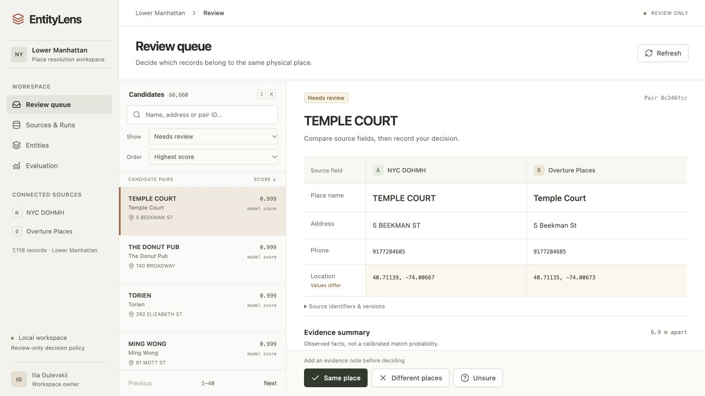

# EntityLens

An ML workbench for comparing independent place catalogs, reviewing uncertain matches and building canonical records with traceable field provenance.

EntityLens currently runs locally on real Lower Manhattan data: **2,222 NYC DOHMH establishments**, **4,896 Overture food and drink places**, and **66,660 candidate pairs**. A CPU-trained gradient boosting classifier ranks pairs. Analysts retain control over every link.



## Run locally

Requires Python 3.12+ and Node 22+; no paid services or API keys.

```sh
make setup
make data
make train
make web
make dev
```

Open http://127.0.0.1:8765 . `make dev` starts the API and durable worker together, using the same database; Ctrl+C stops both. For separate terminals, use `make run` and `make worker` with the same ENTITYLENS_DB. The default local database is `entitylens-v1.db` in the project directory. Interactive API documentation is at `/docs`. `make test` runs safety checks and the production frontend build.

Raw catalogs and model binaries are generated locally and excluded from Git. Preserve the manifest-addressed snapshots to reproduce an exact experiment; the municipal endpoint updates over time. `make data` downloads a bounded area, not the global catalog. Downloading can take several minutes. `docker compose up --build` is an alternative launch after data preparation and training; Docker execution remains unverified in the development environment.

## Workflow

- **Sources & Runs:** inspect immutable snapshot manifests and data quality, queue matching, inspect durable job status, cancel and retry.
- **Review:** search names, addresses and pair IDs; prioritize model/rule disagreement; inspect distance, missing evidence and full-group blockers before deciding. Source fields align in one comparison table; decision actions stay visible. Pair permalinks survive reload. J/K navigates the queue. Narrow windows use separate queue and detail views.
- **Entities:** canonical fields, immutable named decision history, direct pair inspection, undo and bounded JSON/CSV downloads with provenance and spreadsheet-safe strings. Changed entities stay out of exports.
- **Evaluation:** rule baseline, trained classifier and train-only SVD feature ablation with explicit label and split limitations.

Review commits transactionally with idempotency keys, immutable source-version checks, cannot-link enforcement across entire connected groups and conservative branch guards. Undo preserves history. Imports and training are administrative local commands. This workspace has no public authentication or visitor isolation; it should stay on loopback.

## Measured ML result

Training: 4,910 silver pairs; validation: 2,522; geographic holdout: 3,696. The rule baseline has F1 0.99856 on silver labels; both gradient boosting variants reproduce those labels perfectly. **These are heuristic-agreement results, not independently established matching accuracy.** Label rules overlap model features and exclude ambiguous pairs. SVD provides no improvement. Automatic linking stays disabled, scores are not calibrated probabilities, and neural fine-tuning is deferred pending independent labels.

The browser already exposes the consequence: ambiguous renamings can rank highly despite perfect silver metrics. Independent adjudication, outside-candidate recall checks and a newly sealed entity-disjoint test are required before claiming production quality. An 80-row unlabeled stratified review queue is included.

## Engineering status

Implemented: Python/FastAPI, React/TypeScript, SQLite WAL, one leased durable worker, shared feature pipeline, reproducible CPU training, geographic split manifests, local model registry, monitoring endpoints, source-version history, review/undo and safety regression tests.

Planned beyond this local version: PostgreSQL/PostGIS migration, independent gold evaluation, multilingual neural embedding study, lease heartbeats for large jobs, stable canonical IDs across membership changes and authenticated public deployment. No deployed customer or production-scale claim is made.

GitHub Actions is supplied as [a workflow template](docs/ci.yml.template): the available push credential lacks workflow scope, so hosted CI is not enabled. Local checks have been run. Source licenses and raw redistribution require source-specific attribution; full snapshots are not published here.

## Documentation

[Architecture](docs/architecture.md) · [Identity policy](docs/identity-policy.md) · [Labeling](docs/labeling-guide.md) · [Data sources](DATA_SOURCES.md) · [Data card](docs/data-card.md) · [Model card](docs/model-card.md) · [Evaluation](docs/evaluation.md) · [Operations](docs/operations.md) · [Demo script](docs/demo-script.md) · [Progress](PROGRESS.md)

Data attribution: NYC Department of Health and Mental Hygiene; Overture Maps Foundation and suppliers listed in source records. See DATA_SOURCES.md for links and source-specific terms.

## Walkthrough and design

[Testing guide and five use cases](docs/testing-guide.md) · [Design research](docs/design-research.md) · [Polish audit](docs/polish-audit.md)

[Latest analyst workflow improvements](docs/workflow-improvements-2026-10-26.md)

[Workbench redesign and product references](docs/redesign-2026-10-27.md)
